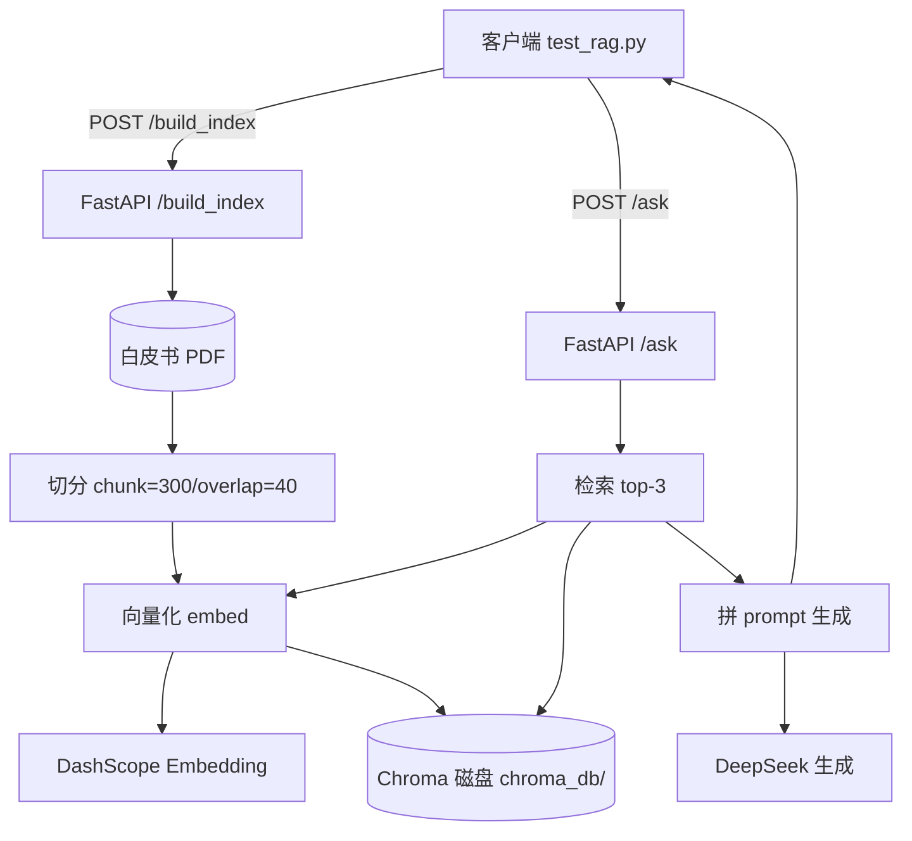
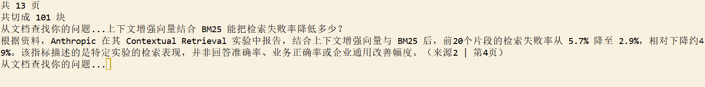

1.**概述**：一个本地文档 RAG 问答系统。把 PDF 白皮书按页切分、向量化存入 Chroma，检索 top-k 片段交给 DeepSeek 生成带页码引用的答案；用 FastAPI 暴露建库/问答两个接口，system prompt 强制「资料没有就直说」来防幻觉。

2.**功能清单**：PDF 按页切分入库 / 向量检索 top-k / 生成带引用页码的答案 / 防幻觉（资料外直说不知道）/ FastAPI 接口（build_index + ask + health）

3.**技术栈**：FastAPI · Chroma · DashScope Embedding · DeepSeek API · LangChain TextSplitter · pypdf · python-dotenv

4.**架构图**：



5.**截图**



6.**快速开始**：

```bash
pip install -r requirements.txt
# 复制 .env.example 为 .env，填入 DEEPSEEK_API_KEY 和 DASHSCOPE_API_KEY
uvicorn main:app --reload
```

另开一个终端建库（首次跑一次即可）：

```bash
python -c "import requests; print(requests.post('http://127.0.0.1:8000/build_index', json={'pdf_path': 'docs/企业RAG知识库建设与使用白皮书.pdf'}).json())"
```

然后问答：

```bash
python test_rag.py
```
